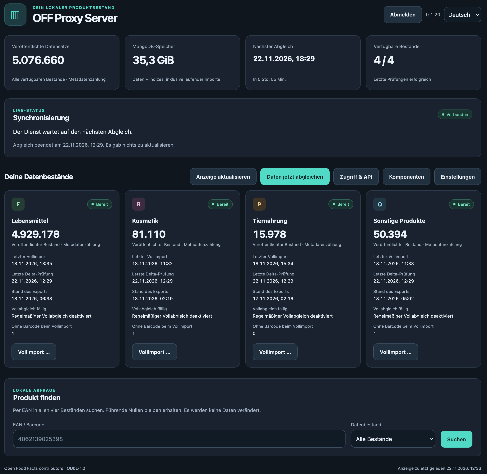

> **Achtung: Frühe Entwicklung. Verwende eine Testinstallation und halte eine Datensicherung bereit.**

# OFF Proxy Server

[English](README.md) · [Anleitung](docs/guide.de.md) · [Releases](https://github.com/Nisbo/off-proxy-server/releases)

Ein selbst gehosteter Produktserver für Barcode-Abfragen. Er hält eine lokale
Kopie von Open Food Facts, Open Beauty Facts, Open Pet Food Facts und Open
Products Facts für die Suche im Dashboard oder per API bereit.



## Schnellstart

1. Du brauchst einen Linux-Rechner mit Docker. Falls Docker fehlt, findest du den
   [Installationsbefehl in der Anleitung](docs/guide.de.md#docker-einrichten).
2. Melde dich auf dem Linux-System als `root` an. Unter Proxmox führst du den
   Befehl in der Konsole der VM oder des Containers aus, in dem Docker läuft.
   Er installiert das neueste veröffentlichte stabile Release.

   ```sh
   curl -fsSL https://raw.githubusercontent.com/Nisbo/off-proxy-server/main/install.sh -o off-proxy-install.sh && bash off-proxy-install.sh
   ```

3. Der Installer fragt im Terminal nach dem Passwort für die Weboberfläche.
   Richte danach den [Zugriff über die IP-Adresse](docs/guide.de.md#zugriff-über-lan-oder-vpn)
   ein. Öffne die Adresse deiner VM oder deines Containers mit Port `8097`
   im Browser und melde dich mit dem Passwort an.
4. Klicke in der Weboberfläche unter **Deine Datenbestände** beim gewünschten
   Bestand auf **Vollimport …**, dann auf **Vollimport starten**. Wiederhole das
   für jeden gewünschten Bestand. Erstimporte startest du manuell. Der erste
   Lebensmittelimport kann Stunden dauern und läuft im Hintergrund. Den
   Fortschritt siehst du unter **Synchronisierung**.

## Nutzung und Updates

- Teste nach dem Lebensmittelimport eine Abfrage unter **Produkt finden**. Gib
  `4062139025398` ein, wähle **Alle Bestände** und klicke auf **Suchen**.
  Derselbe Test im Terminal als `root` geht mit `off-proxy test 4062139025398 all`.
- Unter **Komponenten → Programmupdates** kannst du nach Releases suchen und die Installation starten.
- Die Anleitung enthält [API, Datenabgleich, Sicherungen und Shell-Befehle](docs/guide.de.md).

Code unter der [MIT-Lizenz](LICENSE). Für Produktdaten gelten
[eigene Nutzungsbedingungen](https://world.openfoodfacts.org/data).
