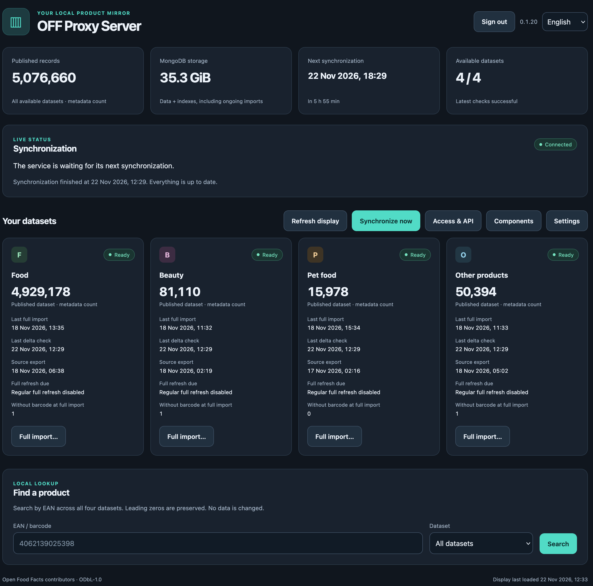

> **Warning: Early development. Use a test installation and keep a backup.**

# OFF Proxy Server

[Deutsch](README.de.md) · [User guide](docs/guide.md) · [Releases](https://github.com/Nisbo/off-proxy-server/releases)

A self-hosted barcode lookup API. Mirror Open Food Facts, Open Beauty Facts,
Open Pet Food Facts and Open Products Facts locally, then look up products by
barcode from the dashboard or a compatible application.



## Quick start

1. You need a Linux machine with Docker. If Docker is missing, follow the
   [Docker setup instructions](docs/guide.md#set-up-docker).
2. Sign in to the Linux system as `root`. On Proxmox, run the command in the
   console of the VM or container running Docker. It installs the latest
   published stable release.

   ```sh
   curl -fsSL https://raw.githubusercontent.com/Nisbo/off-proxy-server/main/install.sh -o off-proxy-install.sh && bash off-proxy-install.sh
   ```

3. Set the dashboard password in the terminal. Press Enter for **All IPv4
   addresses** or [choose your addresses](docs/guide.md#network-access).
   Open one of the browser links shown at the end and sign in.
4. In the dashboard, under **Your datasets**, select **Full import…** on the
   dataset you want, then select **Start full import** to confirm. Repeat for
   each dataset you want. You start initial imports manually. The first food
   import can take hours and runs in the background. Follow its progress
   under **Synchronization**.

## Use and update

- After importing the food dataset, open **Find a product**, enter `4062139025398`, select
  **All datasets** and click **Search**. You can run the same test in the
  terminal as `root` with `off-proxy test 4062139025398 all`.
- Check for releases and start updates under **Components → Program updates**.
- Find the [API, synchronization, backups and CLI commands](docs/guide.md) in the guide.

Code under the [MIT license](LICENSE). Product data has
[separate terms](https://world.openfoodfacts.org/data).
